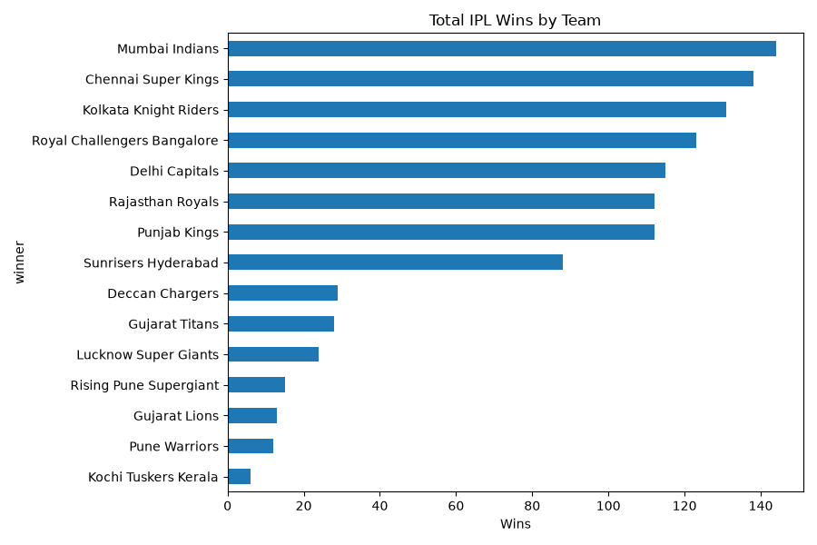
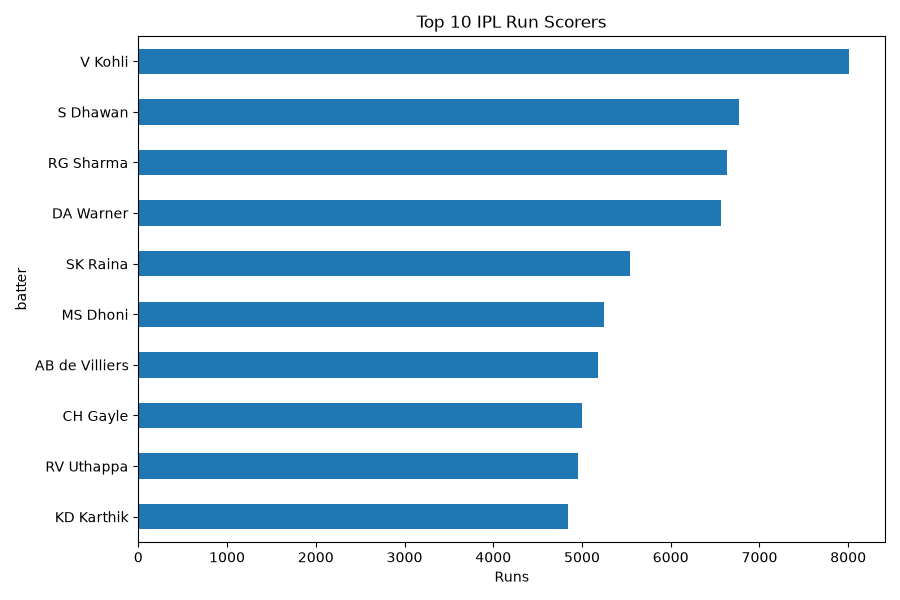

# IPL Cricket Stats Analysis

## Objective
Find out which IPL teams win the most, whether the toss matters,
and who the top run scorers are.

## Data
IPL Complete Dataset from Kaggle (by patrickb1912), covering
1,090 IPL matches with a result, plus ball-by-ball data.
Files used: matches.csv and deliveries.csv.
deliveries.csv is not included because of its size. Download it from the Kaggle dataset "IPL Complete Dataset" by patrickb1912.

## Tools
Python, pandas, matplotlib

## Key Findings
1. Mumbai Indians have the most wins (144), followed by Chennai Super Kings (138)
   and Kolkata Knight Riders (131).
2. The toss winner won the match only 50.8% of the time, so the toss
   gives very little advantage.
3. After winning the toss, teams chose to field in 700 matches and to bat
   in 390, so about 64% prefer to chase.
4. Virat Kohli is the top run scorer with 8,014 runs, ahead of
   Shikhar Dhawan (6,769) and Rohit Sharma (6,630).

## Charts

## Notes
Team names that changed over the years (for example Delhi Daredevils
to Delhi Capitals) were merged before counting wins.
Matches with no result were removed.